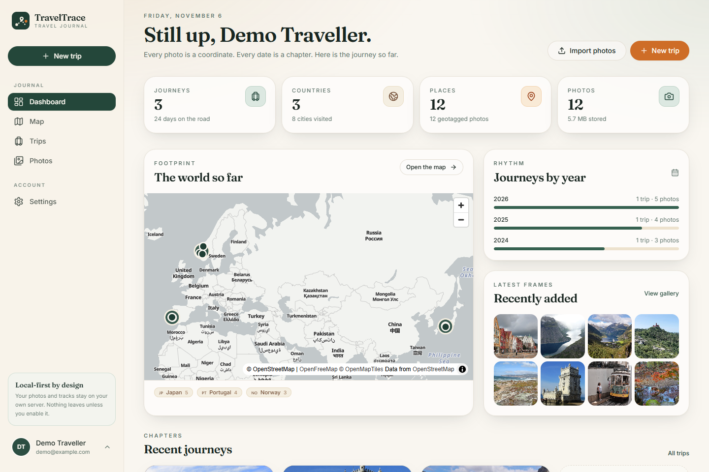
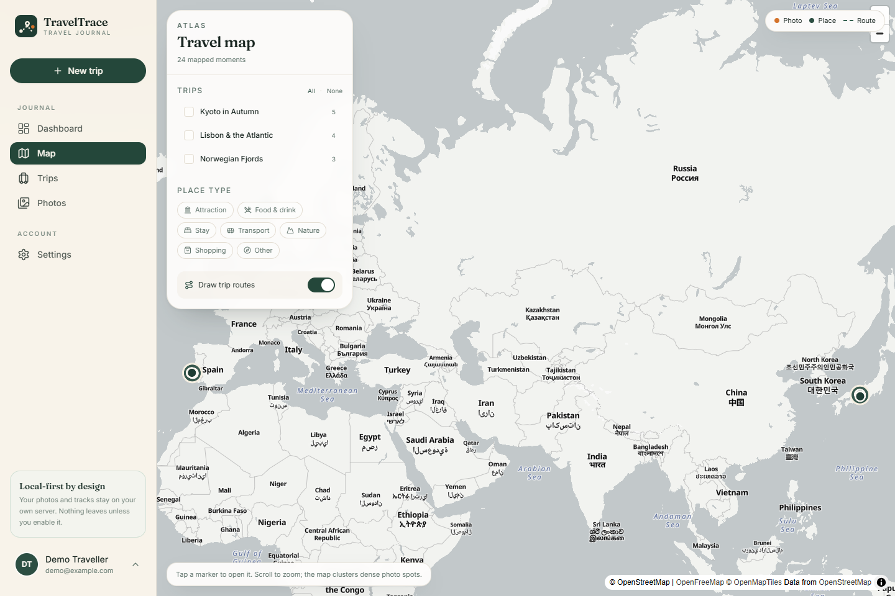
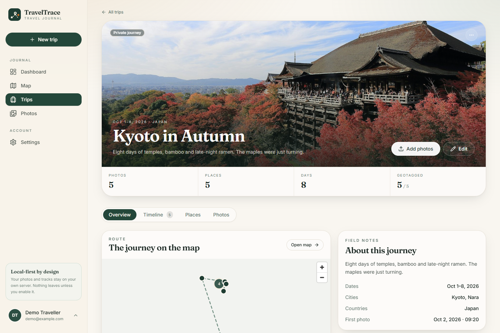
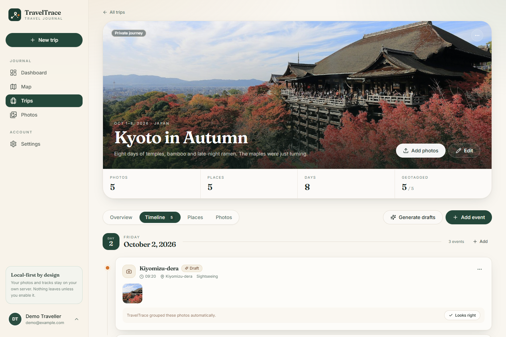
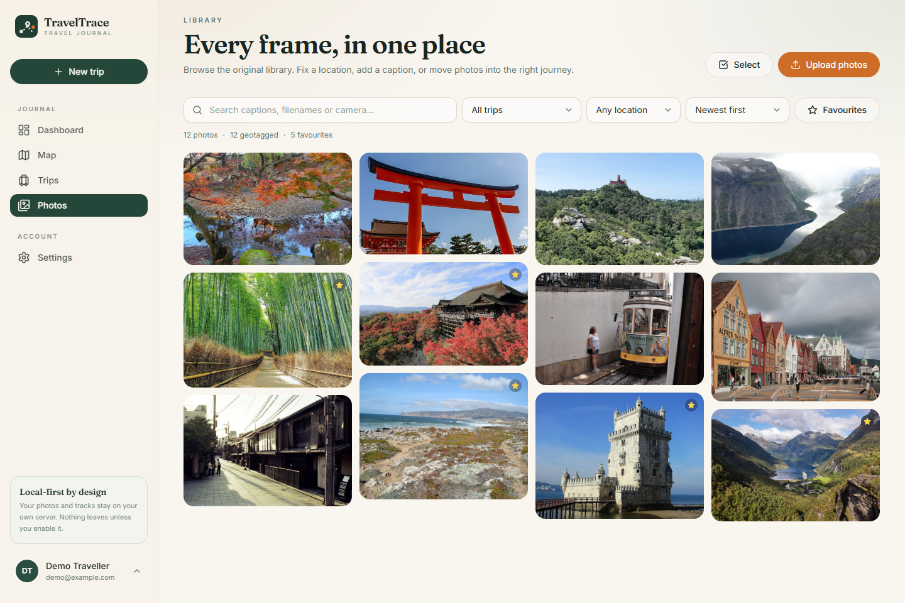
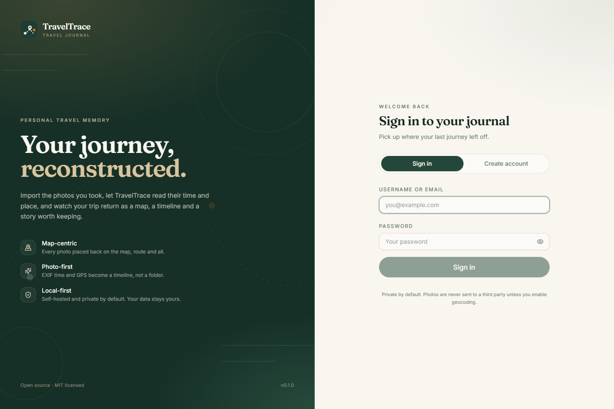
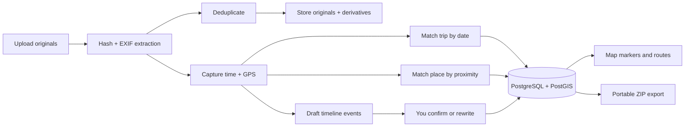

<div align="center">
  
  <h1>TravelTrace</h1>
  <p><strong>Your journey, reconstructed.</strong></p>
  <p>A self-hosted travel journal that turns photo metadata into a map, a timeline and a story worth keeping.</p>

  <p>
    <a href="https://github.com/X-u-Y-a-n-g/TravelTrace/actions/workflows/ci.yml"></a>
    
    <a href="LICENSE"></a>
    
    
    
  </p>

  <p>
    <a href="#quick-start">Quick start</a> ·
    <a href="#screenshots">Screenshots</a> ·
    <a href="docs/architecture.md">Architecture</a> ·
    <a href="docs/api.md">API</a> ·
    <a href="README.zh-CN.md">中文说明</a>
  </p>
</div>



TravelTrace is built for the thousands of photos sitting on your phone after a trip. Instead of
becoming another camera roll, they become a **journey**: every photo is placed back on the map using
its EXIF GPS, grouped by its capture time into a timeline, and connected to the places you visited.

It is **local-first and self-hosted**. Your originals never leave your server unless you explicitly
enable an external geocoding provider. No accounts on someone else's cloud, no analytics, no lock-in.

## Why TravelTrace

| | |
|---|---|
| **Map-centric** | The map is the primary interface, not a side panel. Photos, places and routes live on one canvas. |
| **Photo-first** | Import the originals you already have. EXIF time, GPS and camera data are extracted automatically. |
| **Timeline-driven** | Draft events are generated from photo time and place, then you confirm, merge or rewrite them. |
| **Local-first** | PostgreSQL/PostGIS, local storage and open formats. Everything can be exported as a ZIP. |
| **Honest automation** | The system proposes; you decide. Automatic drafts never overwrite your manual edits. |

## Features in v0.1.0

- **Trips** — create, edit, archive, restore, cover photo, visibility (private / unlisted / public).
- **Photo import** — batch upload, SHA-256 deduplication, EXIF capture time, GPS, camera, lens, orientation, previews and thumbnails without metadata.
- **Photo library** — search, filter by trip / GPS / favourites / date, bulk assign to a trip, manual location correction with a map picker.
- **Places** — reusable places across trips, categories, addresses, visit times and notes.
- **Map** — clustered photo markers, place markers, category and trip filters, GeoJSON route lines, clickable details.
- **Timeline** — rule-based draft generation (time gap + distance + place change), manual events, attach/detach photos, confirm drafts.
- **Dashboard** — journeys, countries, cities, places, photos, days on the road, storage usage, yearly rhythm, recent frames.
- **Portable export** — one ZIP per trip containing `trip.json`, `timeline.json`, `places.geojson`, `photos.json`, `manifest.json` and the original photos.
- **Deployment** — Docker Compose with PostGIS, Redis, a Celery worker, nginx and automatic migrations.
- **Privacy by default** — authenticated image files, private trips, no third-party calls unless you enable geocoding.

## Screenshots

| Dashboard | Travel map |
| --- | --- |
|  |  |

| Trip detail | Timeline |
| --- | --- |
|  |  |

| Photo library | Sign in |
| --- | --- |
|  |  |

## Quick start

### Docker (recommended)

```bash
git clone https://github.com/X-u-Y-a-n-g/TravelTrace.git
cd TravelTrace
cp .env.example .env
```

Edit `.env` and set at least:

```dotenv
POSTGRES_PASSWORD=...        # a long random string
TRAVELTRACE_SECRET_KEY=...   # openssl rand -hex 32
```

Then:

```bash
docker compose up -d --build
```

Open **http://localhost:8080**, create your account, and import your first photos.

The stack contains:

| Service | Role |
| --- | --- |
| `frontend` | nginx serving the React build and proxying `/api` |
| `backend` | FastAPI, SQLAlchemy, Alembic migrations |
| `worker` | Celery worker for photo processing |
| `db` | PostgreSQL 16 + PostGIS 3.4 |
| `redis` | Celery broker and result backend |

Data lives in three named volumes: `db_data`, `redis_data`, `uploads`. Back them up with
`./docker/backup.sh`.

### Demo data (optional)

A seeded demo makes the interface feel alive. It requires a **fresh database**:

```bash
python -m pip install httpx
python demo/seed.py --api http://localhost:8080/api/v1
```

Sign in with **demo / traveltrace-demo**. The script creates three trips, twelve places and twelve
CC-licensed travel photos from `demo/photos/`, then generates draft timelines. See
[`demo/ATTRIBUTION.md`](demo/ATTRIBUTION.md) for image credits.

> The demo account is for local exploration only. Do not seed it on a public instance.

### Local development

Requirements: Python 3.10+, Node.js 20+ (22 recommended), and optionally Docker for PostgreSQL/Redis.

```bash
# Backend (SQLite by default, no external services needed)
python -m venv .venv
source .venv/bin/activate           # Windows: .venv\Scripts\Activate.ps1
pip install -e "backend[dev]"
cd backend
uvicorn app.main:app --reload --port 8000

# Frontend, in a second terminal
cd frontend
npm install
npm run dev
```

Open **http://localhost:5173**. Vite proxies `/api` to the backend. Full instructions, environment
variables and test commands are in [`docs/development.md`](docs/development.md).

## How it works



The backend is a **modular monolith**:

- `api/` — request validation and responses only.
- `services/` — business rules (trips, photos, places, timeline, map, export).
- `repositories/` — reusable SQLAlchemy queries.
- `processors/` — EXIF, thumbnails, clustering and geocoding, independent of HTTP and storage.
- `tasks/` — background execution: inline, thread pool, or Celery.
- `models/` — SQLAlchemy 2.0 entities and portable PostGIS `geography` columns.

Photo uploads return immediately with an import task. A worker extracts metadata, creates
thumbnails, infers the trip and place, and updates progress. The API never blocks on image
processing. Read [`docs/architecture.md`](docs/architecture.md) for the full design.

## Tech stack

| Layer | Choice |
| --- | --- |
| Frontend | React 18, TypeScript, Vite, Tailwind CSS, Radix primitives |
| Mapping | MapLibre GL JS + OpenFreeMap (configurable style) |
| Backend | FastAPI, SQLAlchemy 2.0, Alembic, Pydantic v2 |
| Database | PostgreSQL 16 + PostGIS 3.4 |
| Async | Redis + Celery (or a zero-dependency thread pool) |
| Images | Pillow, optional ExifTool |
| Tests | Pytest, Vitest, Playwright |
| Deploy | Docker Compose, nginx |

## Configuration

All backend settings use the `TRAVELTRACE_` prefix (see [`backend/app/core/config.py`](backend/app/core/config.py)).
The most useful ones:

| Variable | Default | Purpose |
| --- | --- | --- |
| `TRAVELTRACE_DATABASE_URL` | SQLite in `backend/data/` | Database connection string |
| `TRAVELTRACE_STORAGE_DIR` | `backend/data/uploads` | Original and derived image storage |
| `TRAVELTRACE_SECRET_KEY` | generated in the data dir | JWT signing key |
| `TRAVELTRACE_ALLOW_REGISTRATION` | `true` | Close registration after creating your account |
| `TRAVELTRACE_TASK_BACKEND` | `thread` | `inline`, `thread` or `celery` |
| `TRAVELTRACE_GEOCODING_PROVIDER` | `none` | `nominatim` to enable reverse geocoding |
| `TRAVELTRACE_MAX_UPLOAD_MB` | `25` | Per-photo upload limit |
| `TRAVELTRACE_CORS_ORIGINS` | localhost origins | Comma-separated allowed origins |

The frontend reads `VITE_API_BASE` (default `/api/v1`) and `VITE_MAP_STYLE_URL` (default
OpenFreeMap Positron). Use your own map provider in production; public OSM/OpenFreeMap services are
not meant to be unlimited production infrastructure.

## API

Interactive documentation is served at **`/api/docs`** (OpenAPI JSON at `/api/openapi.json`).
Authentication uses a short-lived-from-your-perspective JWT (seven days) returned as a bearer token
and stored in an HttpOnly cookie so images can be loaded directly by the browser.

```bash
curl -s http://localhost:8080/api/v1/auth/login \
  -H 'Content-Type: application/json' \
  -d '{"identifier":"demo","password":"traveltrace-demo"}'
```

See [`docs/api.md`](docs/api.md) for every endpoint, the error format and upload examples.

## Testing

```bash
# Backend (66 tests)
.venv/Scripts/python -m pytest            # Windows
.venv/bin/python -m pytest                # Unix

# Frontend unit tests (18 tests)
cd frontend && npm run test

# End-to-end (Playwright; needs the stack running)
npm run build && npm run preview
npx playwright test
```

The backend suite runs on SQLite for speed. A separate opt-in test validates the PostGIS
`geography` type against a live PostgreSQL database (`TRAVELTRACE_TEST_DATABASE_URL`), and CI runs
it against the `postgis/postgis` service.

## Project layout

```
TravelTrace/
├── backend/            FastAPI app, models, services, processors, Alembic migrations
├── frontend/           React + TypeScript + MapLibre UI
├── demo/               Seed script and CC-licensed demo photos
├── docs/               Architecture, database, API, development and deployment guides
├── docker/             Operational helpers (backup)
├── tests/backend/      Pytest suite
├── shared/             Generated OpenAPI contract
├── docker-compose.yml
├── .env.example
└── README.md
```

## Roadmap

- **v0.2.0 — Travel Reconstruction** — GPX / GeoJSON / KML import, track-to-photo matching, smarter
  clustering, automatic place recognition, daily summaries.
- **v0.3.0 — Memory Experience** — journals, memory books, HTML/PDF export, richer statistics,
  public share pages.
- **v1.0.0 — Intelligent Travel Platform** — optional AI summaries, personalised recommendations,
  multi-device sync, collaboration and plugin data sources.

The v0.1.0 goal is intentionally narrow: make the loop **upload → map → timeline → edit → export**
complete, stable and pleasant. AI and social features are not part of this release.

## Privacy and security

- Trips are **private by default**; visibility is a per-trip choice.
- Original images are only served to the authenticated owner.
- Thumbnails and previews are generated **without EXIF metadata**.
- Reverse geocoding is **disabled by default** and never runs during upload.
- Import tasks are isolated per user; deduplication is scoped per account.
- Every trip can be exported in open formats — no lock-in.

See [`SECURITY.md`](SECURITY.md) for reporting vulnerabilities and the production checklist.

## Contributing

Contributions are welcome. Read [`CONTRIBUTING.md`](CONTRIBUTING.md) for the development setup,
code conventions and pull-request checklist.

## License

[MIT](LICENSE) © 2026 XuYang

## Acknowledgements

- Map data © [OpenStreetMap](https://www.openstreetmap.org/copyright) contributors, rendered with
  [MapLibre GL JS](https://maplibre.org/) and [OpenFreeMap](https://openfreemap.org/).
- Demo photography from Wikimedia Commons under free licenses — see
  [`demo/ATTRIBUTION.md`](demo/ATTRIBUTION.md).
- Built with FastAPI, SQLAlchemy, React, Tailwind CSS, Radix UI, and the Fraunces + Inter typefaces.
