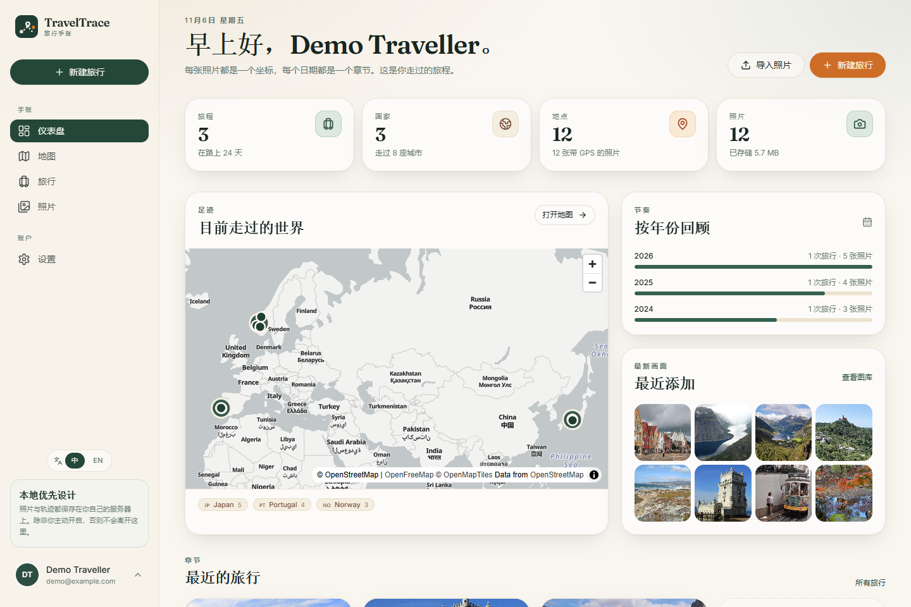
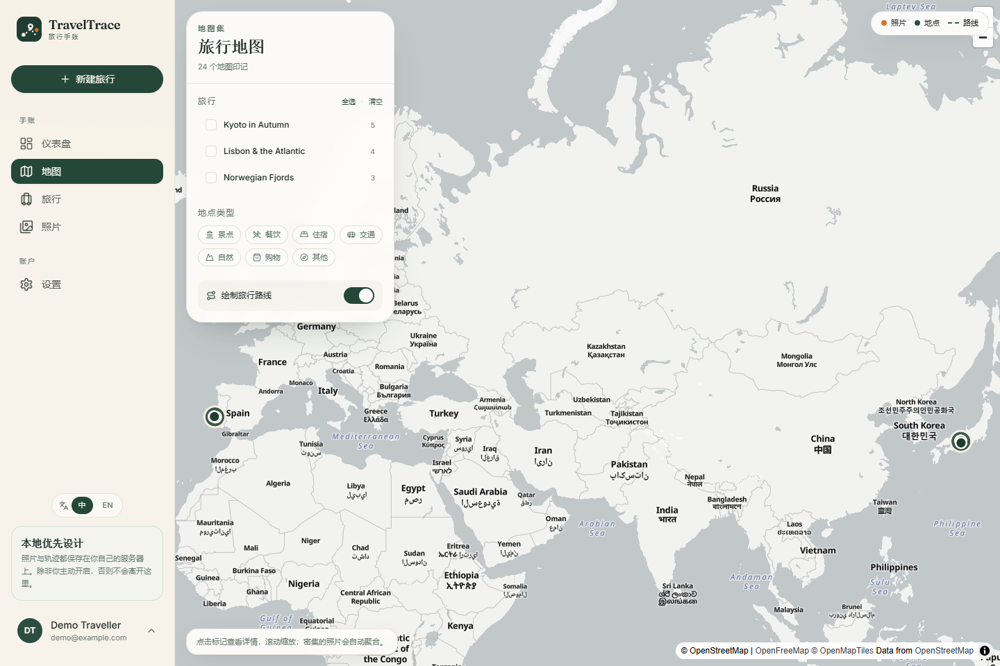
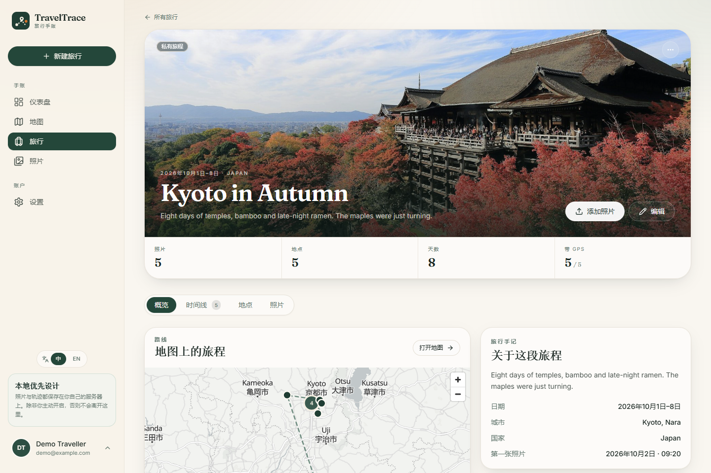
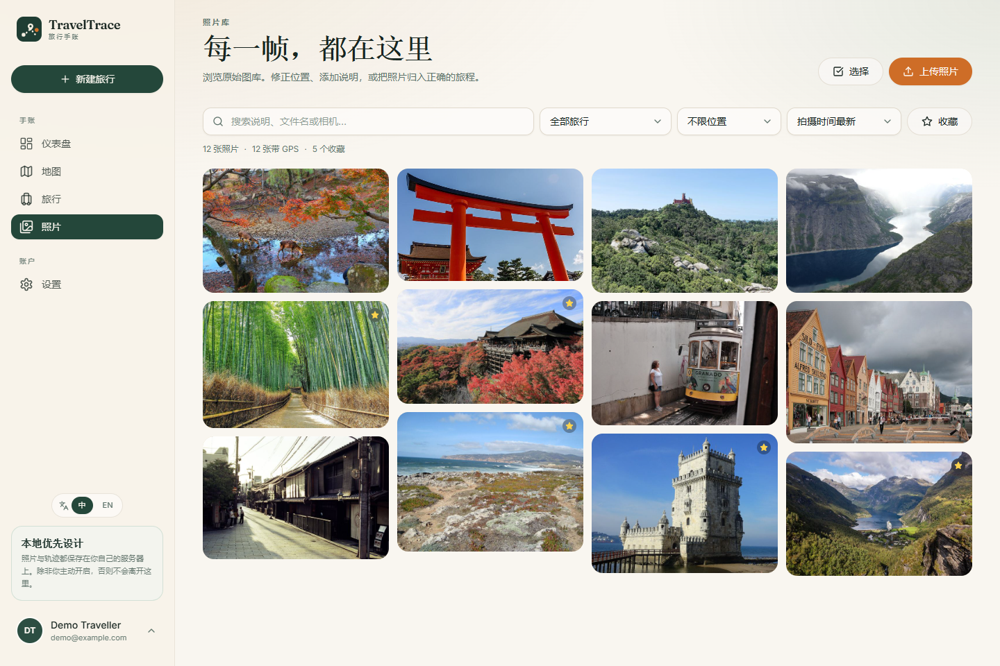

<div align="center">
  
  <h1>TravelTrace</h1>
  <p><strong>你的旅程，重新展开。</strong></p>
  <p>以地图为核心、照片为线索、时间线为载体的自托管旅行记忆系统。</p>

  <p>
    <a href="https://github.com/X-u-Y-a-n-g/TravelTrace/actions/workflows/ci.yml"></a>
    
    <a href="LICENSE"></a>
    
    
  </p>

  <p>
    <a href="#快速开始">快速开始</a> ·
    <a href="#功能">功能</a> ·
    <a href="docs/architecture.md">架构</a> ·
    <a href="docs/api.md">API</a> ·
    <a href="README.md">English</a>
  </p>
</div>



旅行结束后，手机里往往留下成百上千张照片。TravelTrace 让它们不再只是相册：读取照片中的 EXIF
拍摄时间与 GPS，把照片放回地图、按时间组织成旅行事件，并连接到你真正到访过的地点。

它**默认私有、支持自托管**。原图保存在你自己的服务器上；除非你主动启用外部地理编码服务，否则不会有
任何坐标离开你的实例。没有第三方统计，没有锁定，所有数据都可以导出。

## 功能

- **旅行管理**：创建、编辑、归档、恢复、封面、可见性（私有 / 不公开 / 公开）。
- **照片导入**：批量上传、SHA-256 去重、EXIF 时间 / GPS / 相机 / 镜头、缩略图与预览图（不含 EXIF）。
- **照片库**：搜索、按旅行 / GPS / 收藏 / 日期筛选、批量归入旅行、地图选点手动修正位置。
- **地点管理**：可复用地点、分类、地址、到访时间与备注，同一次旅行可多次到访同一地点。
- **地图**：照片聚合点、地点标记、旅行路线（GeoJSON）、按旅行与分类筛选。
- **时间线**：基于时间间隔与距离的规则聚类，自动生成草稿事件；支持手动事件、增删照片、确认草稿。
- **仪表盘**：旅行 / 国家 / 城市 / 地点 / 照片 / 在天数 / 存储用量、年度节奏、最近照片。
- **开放导出**：每次旅行导出 ZIP，包含 `trip.json`、`timeline.json`、`places.geojson`、
  `photos.json`、`manifest.json` 与原图。
- **一键部署**：Docker Compose（PostGIS + Redis + Celery worker + nginx），自动执行数据库迁移。
- **中英双语**：完整中文 / 英文界面，默认中文，登录页、侧边栏和设置中均可切换，选择会被记住。
- **隐私优先**：默认私有、原图鉴权访问、默认不调用任何第三方服务。

## 截图

| 仪表盘 | 地图 |
| --- | --- |
|  |  |

| 旅行详情 | 时间线 |
| --- | --- |
|  |  |

| 照片库 | 登录 |
| --- | --- |
|  |  |

## 快速开始

### Docker 部署（推荐）

```bash
git clone https://github.com/X-u-Y-a-N-g/TravelTrace.git
cd TravelTrace
cp .env.example .env
```

编辑 `.env`，至少设置：

```dotenv
POSTGRES_PASSWORD=一段足够长的随机字符串
TRAVELTRACE_SECRET_KEY=使用 openssl rand -hex 32 生成
```

然后启动：

```bash
docker compose up -d --build
```

打开 **http://localhost:8080**，注册账号并导入第一组照片。

数据保存在三个 Docker volume 中：`db_data`、`redis_data`、`uploads`。备份请运行
`./docker/backup.sh`。生产环境请务必在反向代理后启用 HTTPS，并在注册完成后关闭注册。

### 演示数据（可选）

在**全新数据库**上运行：

```bash
python -m pip install httpx
python demo/seed.py --api http://localhost:8080/api/v1
```

使用 **demo / traveltrace-demo** 登录。脚本会创建 3 次旅行、12 个地点与 12 张 CC 授权旅行照片，
并生成草稿时间线。照片来源见 [`demo/ATTRIBUTION.md`](demo/ATTRIBUTION.md)。

> 演示账号仅用于本地体验，请勿在公网实例上运行种子脚本。

### 本地开发

```bash
# 后端（默认 SQLite，无需外部服务）
python -m venv .venv
.venv\Scripts\Activate.ps1        # macOS/Linux: source .venv/bin/activate
pip install -e "backend[dev]"
cd backend
uvicorn app.main:app --reload --port 8000

# 前端（另一个终端）
cd frontend
npm install
npm run dev
```

打开 <http://localhost:5173>。完整的环境变量、测试与开发约定见
[`docs/development.md`](docs/development.md)。

## 技术与架构

| 层 | 技术 |
| --- | --- |
| 前端 | React 18、TypeScript、Vite、Tailwind CSS、Radix UI |
| 地图 | MapLibre GL JS + OpenFreeMap（可配置样式） |
| 后端 | FastAPI、SQLAlchemy 2.0、Alembic、Pydantic v2 |
| 数据库 | PostgreSQL 16 + PostGIS 3.4（开发可用 SQLite） |
| 异步 | Redis + Celery（也可用零依赖线程池） |
| 图片 | Pillow，可选 ExifTool |
| 测试 | Pytest、Vitest、Playwright |
| 部署 | Docker Compose、nginx |

后端是**模块化单体**：`api` 只做请求校验与响应，`services` 承载业务规则，`repositories` 封装查询，
`processors` 负责 EXIF、缩略图、聚类和地理编码，`tasks` 负责异步任务。上传照片后立即返回任务 ID，
worker 在后台提取元数据、生成缩略图、推断旅行与地点并更新进度，API 不会阻塞在图片处理上。

时间线使用可解释的规则引擎（时间间隔 + 空间距离 + 地点变化），而不是黑盒模型；自动生成的事件状态为
`draft`，用户确认后才会变为 `confirmed`，且重新生成不会覆盖手动事件。这正是 TravelTrace 的产品原则：
**自动化负责还原，用户负责确认。**

更多内容：

- [架构设计](docs/architecture.md)
- [数据库设计](docs/database.md)
- [API 文档](docs/api.md)
- [开发指南](docs/development.md)
- [部署指南](docs/deployment.md)

## 测试

```bash
# 后端（SQLite 隔离测试库；PostGIS 集成测试按需启用）
python -m pytest

# 前端单元测试
cd frontend && npm run test

# 端到端测试（需先启动 API 与前端预览）
npx playwright test
```

GitHub Actions 会运行后端 lint 与测试（含 PostGIS 服务）、前端 lint / 类型检查 / 单元测试 / 构建、
Playwright 端到端测试以及 Docker 镜像构建。

## 隐私与安全

- 旅行默认私有，可见性由用户逐项选择。
- 原图只对已认证的所有者开放；缩略图与预览图会移除 EXIF。
- 反向地理编码默认关闭，导入照片时不会调用任何外部服务。
- 完整的中文 / 英文界面，默认中文，可在登录页、侧边栏和设置中随时切换。
- 导入任务按用户隔离，去重也只在同一账号内进行。
- 所有旅行都可导出为开放格式，不锁定数据。

安全问题请参阅 [`SECURITY.md`](SECURITY.md)。生产部署前请阅读
[`docs/deployment.md`](docs/deployment.md) 的安全检查清单。

## 路线图

- **v0.2.0 — Travel Reconstruction**：GPX / GeoJSON / KML 导入、轨迹与照片匹配、自动事件生成增强、
  每日摘要、地点自动识别。
- **v0.3.0 — Memory Experience**：旅行日志、回忆册、HTML / PDF 导出、分享页面、旅行统计。
- **v1.0.0 — Intelligent Travel Platform**：AI 摘要、个性化推荐、多设备同步、多人协作、插件数据源。

v0.1.1 有意保持聚焦：先把 **上传 → 地图 → 时间线 → 编辑 → 导出** 这条闭环做完整、稳定、好用。

## 贡献

欢迎提交 Issue 与 Pull Request。开发环境、代码规范与提交前检查见
[`CONTRIBUTING.md`](CONTRIBUTING.md)。

## 许可证

[MIT](LICENSE) © 2026 XuYang

## 致谢

- 地图数据 © [OpenStreetMap](https://www.openstreetmap.org/copyright) 贡献者，使用
  [MapLibre GL JS](https://maplibre.org/) 与 [OpenFreeMap](https://openfreemap.org/) 渲染。
- 演示照片来自 Wikimedia Commons，遵循各自的自由许可，详见
  [`demo/ATTRIBUTION.md`](demo/ATTRIBUTION.md)。
- 使用 FastAPI、SQLAlchemy、React、Tailwind CSS、Radix UI 以及 Fraunces + Inter 字体构建。
