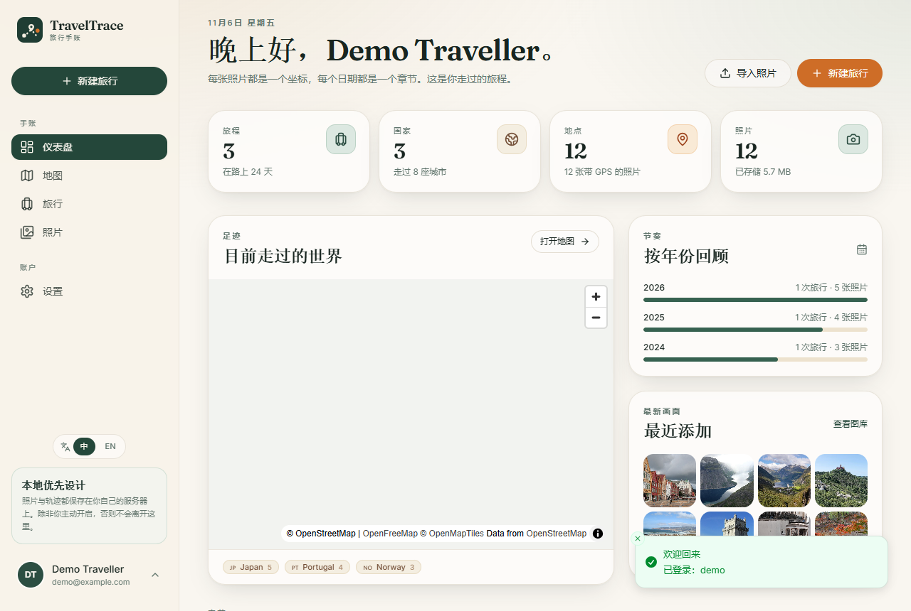

# TravelTrace Desktop (Windows EXE)

The desktop build is a single-machine TravelTrace: FastAPI, SQLite, the local photo store and the
React UI run inside one Windows executable. It does not need Docker, PostgreSQL, a separate server
process or a browser.

## What it does

- Opens a native window (pywebview / WebView2) at a local, random port.
- Stores the database in `%APPDATA%\TravelTrace\traveltrace.db`.
- Stores originals, previews and thumbnails in `%APPDATA%\TravelTrace\uploads`.
- Generates and persists a local JWT secret in `%APPDATA%\TravelTrace\.secret_key`.
- On first launch, detects nearby `backend\data` / `data` / `.cache\devdata` folders and offers to
  import the existing SQLite database and photo directory.
- Keeps the existing account/trip data, so the old login still works after import.
- Uses only the local backend; the only optional network access is map tile loading.

## Build

Requirements: Python 3.10+, Node.js 20+, JDK not required.

```powershell
cd E:\activity\TravelTrace
python -m venv .venv
.\.venv\Scripts\python.exe -m pip install -e "backend[dev]"
.\.venv\Scripts\python.exe -m pip install -r desktop\requirements.txt
cd frontend
npm ci
npm run build
cd ..
.\desktop\build.ps1
```

If PowerShell blocks the script, run:

```powershell
powershell -ExecutionPolicy Bypass -File .\desktop\build.ps1
```

Or invoke PyInstaller directly:

```powershell
.\.venv\Scripts\pyinstaller.exe desktop\traveltrace.spec --noconfirm --clean
```

The one-file executable is `dist\TravelTrace.exe`. It needs the Microsoft Edge WebView2 runtime,
which is present on current Windows 10/11 installations.

A prebuilt debug/standalone build is included at `desktop\TravelTrace-0.3.0.exe`
(SHA-256 `1B16BD27E1A6609CC5FE41BA6AB406818B000FB973A08BE01385F619B04DC9D6`).



## Run

Double-click `TravelTrace.exe`. On first launch:

- If a previous data folder is found, confirm the import prompt.
- Otherwise register a local account and start adding trips and photos.

Useful command-line options:

```text
--data-dir PATH        Store the database and uploads under PATH
--import-data PATH     Import a traveltrace.db + uploads folder before starting
--headless             Run the local API without opening a window
--check                Start, verify the API and UI, then exit
--port N               Use a fixed local port (default: random)
--no-import-prompt     Skip the first-run import dialog
```

Example migration without the dialog:

```powershell
.\TravelTrace.exe --import-data "E:\activity\TravelTrace\.cache\devdata" --check
```

Example custom data location:

```powershell
.\TravelTrace.exe --data-dir "D:\TravelTraceData"
```

## Local API

The desktop app uses the same REST API as the web version, on a loopback-only port. It is not exposed
to the LAN. The API docs are available at `/api/docs` while the app is running.

## Notes

- Existing data import supports **SQLite** databases. A PostgreSQL dump must be migrated to SQLite
  first; the current backend uses SQLite for single-machine mode.
- The one-file EXE extracts itself to a temporary directory at startup. If Windows blocks the
  default temp folder, set `TEMP`/`TMP` to a writable directory or build a onedir distribution.
- Use the built-in export ZIP for backups. The `%APPDATA%\TravelTrace` folder can also be copied
  while the app is closed.
