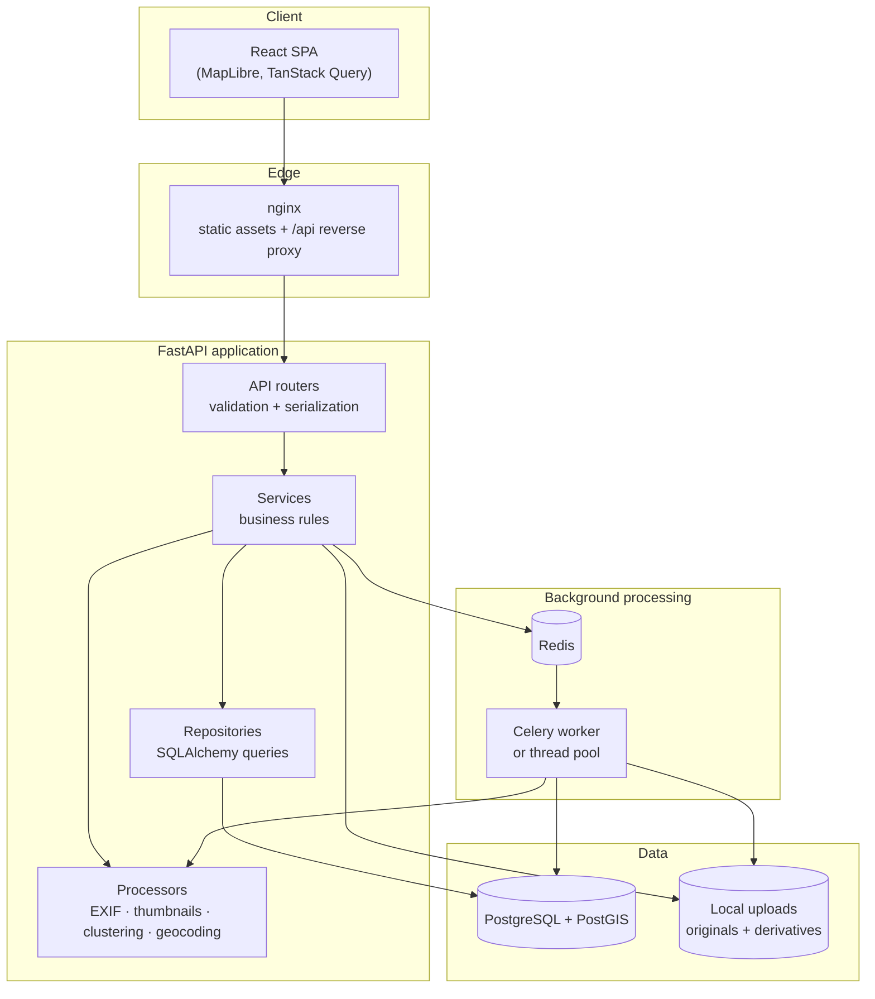
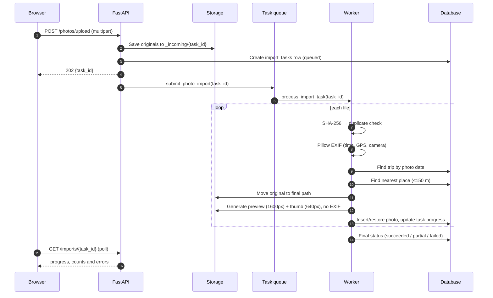
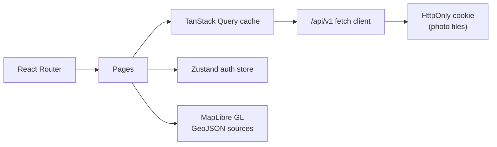

# Architecture

TravelTrace v0.2.0 is a **modular monolith** with an asynchronous processing pipeline and a
separate frontend build. The design goal is to make the core loop — *import photos → reconstruct
the map and timeline → edit → export* — complete and dependable, while leaving clear seams for
tracks, journals and AI features in later releases.

## System context



The only mandatory services are the API, a database and a writable storage directory. Redis and
the worker are required only when `TRAVELTRACE_TASK_BACKEND=celery`; the default development mode
uses an in-process thread pool, and tests use the inline backend.

## Runtime components

| Component | Responsibility |
| --- | --- |
| `frontend` | React SPA, MapLibre map, forms, upload progress, timeline editing |
| `backend` | REST API, authentication, authorization, import scheduling, export |
| `worker` | EXIF extraction, thumbnails, trip/place inference, task progress |
| `db` | Durable data and PostGIS spatial columns |
| `redis` | Celery broker/result backend |
| `nginx` | Serves the SPA, proxies `/api`, enforces upload size and security headers |

## Backend layering

The backend deliberately separates concerns so that image processing and spatial logic never leak
into HTTP handlers.

```
app/
├── api/            Routers, dependency wiring, cookies
├── services/       Use cases and transaction boundaries
├── repositories/   Reusable SQLAlchemy query builders
├── processors/     Pure-ish image, EXIF, geocoding and clustering logic
├── tasks/          Task runner abstraction + Celery application
├── models/         SQLAlchemy entities and enums
├── schemas/        Pydantic request/response contracts
├── db/             Engine, sessions, declarative base
└── core/           Settings, errors, security, geo primitives
```

Rules of thumb:

- **Routers** validate input, resolve the current user, call one service and return a schema. They do
  not build complex queries.
- **Services** own business rules (trip date validation, ownership checks, timeline generation) and
  commit transactions.
- **Repositories** encapsulate reusable filters such as "visible photos of this user", avoiding a
  dozen subtly different `WHERE deleted_at IS NULL` clauses.
- **Processors** are reusable outside HTTP: the same EXIF and clustering code can run in a CLI, a
  Celery worker or a future batch job.

## Photo import pipeline



Key properties:

- **Deduplication** is per user using a unique `(user_id, content_hash)` constraint. Re-uploading a
  soft-deleted photo restores it rather than creating a second row.
- **Metadata never overwrites originals.** Photos are stored byte-for-byte; GPS stored in the
  database can be corrected by the user via `gps_source=manual` while the file stays untouched.
- **Capture timestamps** keep the camera's local wall-clock time plus the UTC offset when the camera
  recorded one. This makes "day of the trip" grouping match the photographer's experience.
- **Failures are isolated per file.** One corrupt image does not fail the whole batch; the task ends
  as `partial` with per-file errors.
- **Cancellation** is cooperative: the worker checks the task status between files.

## Timeline reconstruction

v0.2.0 intentionally uses an explainable rule engine instead of a trained model.

1. Collect photos with a capture time in the trip (excluding photos already in a manual or confirmed
   event).
2. Sort by time and group per calendar day.
3. Start a new event when any of these is true:
   - the gap to the previous photo exceeds `max_gap_minutes` (default 180),
   - the great-circle distance exceeds `max_distance_km` (default 3),
   - the known place changes and the gap is longer than 30 minutes.
4. Title the event with the dominant place name, otherwise `"{morning|afternoon|...} in {city}"`, or
   `"{period} moments"`.
5. Persist events with `source=auto`, `status=draft`, linked through `event_media`.
6. Never delete manual events. Regeneration removes only previous auto drafts; photos inside manual
   or confirmed events are excluded from clustering.

The user can edit any draft, attach or detach photos, or confirm it ("Looks right"), which changes its
status to `confirmed`. This is the product principle in code: **automation proposes, the user
decides**.

## Spatial data strategy

Coordinates are stored twice:

- `latitude` / `longitude` as `double precision`, used for portable bounding-box queries, sorting and
  application logic (works identically on SQLite and PostgreSQL).
- `location` as a PostGIS `geography(Point, 4326)` on PostgreSQL, maintained by a mapper hook,
  with GIST indexes created in the baseline migration.

A custom `GeoPoint` type renders `geography(POINT, 4326)` on PostgreSQL and WKT text on SQLite. This
lets the full test suite run without a database server while production keeps real spatial types for
future proximity, route and polygon queries. Map requests currently use latitude/longitude bounding
boxes; the GIST indexes are already in place for the next iterations.

## Authentication and file access

- A stateless JWT (HS256, issuer `traveltrace`, seven-day expiry) is returned in the login response
  and also set as an `HttpOnly`, `SameSite=Lax` cookie.
- API clients send `Authorization: Bearer …`; cookie authentication is the fallback, which allows
  `` to work without a custom fetch layer.
- The `Secure` flag follows the request scheme, so HTTP self-hosting and HTTPS deployments both work.
- Photo files are streamed through an authenticated endpoint; there is no static directory exposed for
  originals. Thumbnails and previews are safe derivatives with EXIF stripped.
- Password hashing uses bcrypt (cost 12); JWTs are signed with a key from the environment or a
  generated key persisted in the data directory.
- Ownership is enforced on every trip, place, photo, event and export query by scoping to
  `user_id`. Missing and unauthorized resources return the same `404`.

## Background task abstraction

`app/tasks/queue.py` defines a tiny runner protocol with three implementations:

| Backend | When to use | Behaviour |
| --- | --- | --- |
| `inline` | Tests, single-photo experiments | Runs during the upload request |
| `thread` | Default local development | Small `ThreadPoolExecutor` inside the API process |
| `celery` | Docker Compose and larger deployments | Enqueues to Redis, processed by a separate worker |

The processing function always opens its own database session, so it is safe in a worker thread or
process. Import tasks are the single source of truth for progress and errors.

## Storage layout

```
<storage_dir>/
└── <user_id>/
    ├── <photo_id[0:2]>/
    │   └── <photo_id>.jpg            # original, untouched
    ├── derived/
    │   ├── <photo_id>_preview.jpg    # max 1600px, JPEG, no EXIF
    │   └── <photo_id>_thumb.jpg      # max 640px, JPEG, no EXIF
    └── _incoming/<task_id>/          # temporary uploads, cleaned after a task
```

The database stores paths relative to the storage root, which makes the data directory relocatable
and compatible with a Docker volume. A storage abstraction isolates the rest of the code from the
filesystem; an S3-compatible backend can be added without touching services.

## Frontend



- **Server state** lives in TanStack Query; mutations invalidate the affected keys (`trips`,
  `photos`, `stats`, `map`, `timeline`).
- **Session state** (JWT + user) lives in a persisted Zustand store.
- **Map** uses one component with GeoJSON sources: clustered photo points, place points and route
  lines. Filters are re-queried server-side; the map refits when the filter signature changes.
- **Design system** is a small set of accessible primitives built on Radix (dialog, sheet, tabs,
  dropdown, tooltip, switch) styled with Tailwind and the Fraunces/Inter typefaces.
- **Internationalisation** uses a small typed provider in `frontend/src/i18n`. English and Chinese
  dictionaries expose the same keys, `useI18n()` provides `t()` for copy and locale-aware date
  formatters, and the selected language is persisted in `localStorage`. Chinese is the default;
  `<html lang>` follows the active locale.
- **Error handling** is centralized in the fetch client: the API's normalized error envelope becomes
  an `ApiError` with `status`, `code`, `message` and optional field details.

## Deployment topology

`docker compose` runs nginx, FastAPI, a Celery worker, PostgreSQL/PostGIS and Redis. The browser talks
only to nginx; nginx proxies `/api` to FastAPI. Migrations run in the backend entrypoint before the
server starts. Uploads and the database live in named volumes. See
[deployment.md](deployment.md) for backup, upgrade and HTTPS details.

## Deliberate v0.2.0 boundaries

- No GPX/KML/FIT import or track-to-photo matching yet (schema exists; scheduled for v0.2.0).
- No journals, memory books, PDF export or public share pages (v0.3.0).
- No AI, recommendations or collaboration.
- HEIC/HEIF uploads are rejected; JPEG, PNG and WebP are supported.
- Only local disk storage is implemented (the abstraction is ready for S3).
- Registration is open by default; there is no email verification or password reset. A public
  instance should close registration after creating accounts and run behind HTTPS.
- Map tiles and geocoding are configurable third-party dependencies with their own terms; the
  defaults are suitable for development, not unlimited production traffic.

## Decisions

| Decision | Choice | Why |
| --- | --- | --- |
| Architecture | Modular monolith | One deployable API, clear modules, low operational cost |
| Spatial storage | PostGIS `geography` + portable double columns | Real spatial capability without losing SQLite testability |
| Timestamps | Camera-local wall clock + offset | Day grouping matches the trip, not the server timezone |
| Async | Pluggable inline/thread/Celery | Zero setup in development, real workers in production |
| Photo identity | SHA-256 per user | Cheap duplicate detection, soft-delete aware |
| Timeline | Rules, not ML | Explainable, fast, editable, no training data required |
| Data portability | ZIP with JSON + GeoJSON + originals | No lock-in; aligns with the local-first promise |
| Map | MapLibre + configurable style | No vendor lock-in; OpenFreeMap default |
