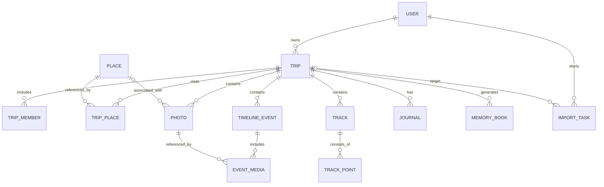

# Database

TravelTrace uses **PostgreSQL 16 + PostGIS 3.4** in production and SQLite for local development and
the test suite. The schema is defined with SQLAlchemy 2.0 typed models and a single Alembic baseline
(`0001_initial`); the same migration runs on both engines.

## Entity relationship



The `track`, `track_point`, `journal` and `memory_book` tables are part of the forward-looking schema.
Their APIs arrive in v0.2/v0.3; the v0.2.0 interface does not expose them yet.

## Tables

### `users`

| Column | Type | Notes |
| --- | --- | --- |
| `id` | UUID | Primary key |
| `username` | varchar(50) | Unique, case-insensitive lookups |
| `email` | varchar(255) | Unique, stored lowercase |
| `password_hash` | varchar(255) | bcrypt, cost 12 |
| `display_name` | varchar(100) | Optional |
| `is_active` | boolean | Default `true` |
| `last_login_at` | timestamptz | Updated on login |
| `created_at`, `updated_at` | timestamptz | UTC |

### `trips`

A trip is a chapter: a bounded journey with dates and visibility. It is soft-deleted so it can be
restored together with its timeline.

| Column | Type | Notes |
| --- | --- | --- |
| `id` | UUID | Primary key |
| `user_id` | UUID | → `users.id` (`ON DELETE CASCADE`) |
| `title` | varchar(160) | Required |
| `description` | text | Optional |
| `start_date`, `end_date` | date | Optional, but ordering is enforced |
| `visibility` | varchar(16) | `private` / `unlisted` / `public` |
| `cover_photo_id` | UUID | Denormalised reference; not a FK to avoid a table cycle |
| `deleted_at` | timestamptz | Soft delete |
| `created_at`, `updated_at` | timestamptz | UTC |

Constraints/indexes: `CHECK` on date ordering, `(user_id, start_date)`, `deleted_at`.

### `trip_members`

Prepared for collaboration. v0.2.0 creates one `owner` row per trip; authorization still checks the
trip owner only.

| Column | Type | Notes |
| --- | --- | --- |
| `trip_id`, `user_id` | UUID | Unique together |
| `role` | varchar(16) | `owner` / `editor` / `viewer` |
| `sort_order` | integer | Display order |

### `places`

A reusable location, independent of visits. One place can appear in many trips and years.

| Column | Type | Notes |
| --- | --- | --- |
| `id` | UUID | Primary key |
| `user_id` | UUID | Owner |
| `name` | varchar(255) | Required |
| `category` | varchar(24) | attraction, food, lodging, transport, nature, shopping, other |
| `address`, `city`, `region`, `country`, `country_code` | text/varchar | Optional metadata |
| `latitude`, `longitude` | double precision | Authoritative for reads and filters |
| `location` | geography(Point, 4326) | PostGIS; WKT text on SQLite |
| `notes`, `source`, `external_id` | — | Manual/geocoded provenance |

### `trip_places`

A visit: the association object between a trip and a place, with arrival/departure and ordering.
Keeping this separate allows the same place to be visited twice in different years (or twice in one
trip).

### `photos`

| Column | Type | Notes |
| --- | --- | --- |
| `id` | UUID | Primary key |
| `user_id` | UUID | Owner |
| `trip_id` | UUID? | `ON DELETE SET NULL`; nullable for unsorted photos |
| `place_id` | UUID? | `ON DELETE SET NULL` |
| `file_path`, `preview_path`, `thumb_path` | text | Relative to storage root |
| `original_filename` | varchar(255) | Display name, not a path |
| `mime_type`, `file_size` | — | Detected from bytes |
| `content_hash` | varchar(64) | SHA-256; unique with `user_id` |
| `width`, `height` | integer | Oriented dimensions |
| `taken_at` | timestamp | Camera-local wall clock (see below) |
| `taken_at_offset_minutes` | integer? | From EXIF `OffsetTimeOriginal` when present |
| `latitude`, `longitude` | double precision | Current best coordinates |
| `location` | geography(Point, 4326) | Mirrored by a mapper hook |
| `gps_source` | varchar(16) | `exif`, `manual`, `track`, `inferred`, `none` |
| `camera_make`, `camera_model`, `lens`, `orientation` | — | EXIF |
| `caption`, `is_favorite` | — | User edits |
| `status` | varchar(16) | `pending` / `processing` / `ready` / `failed` |
| `metadata` | jsonb | Selected EXIF fields (JSON on SQLite) |
| `deleted_at` | timestamptz | Soft delete; re-upload restores the row |

Indexes: unique `(user_id, content_hash)`, `(user_id, taken_at)`, `(trip_id, taken_at)`,
`(latitude, longitude)`, plus a GIST index on `location` on PostgreSQL.

### `timeline_events` and `event_media`

| `timeline_events` | Notes |
| --- | --- |
| `trip_id` | `ON DELETE CASCADE` |
| `place_id` | Optional, `ON DELETE SET NULL` |
| `title`, `description`, `event_type` | Content |
| `start_time`, `end_time` | Local wall clock |
| `day` | Denormalised date used for grouping and indexing |
| `sort_order` | Within the day |
| `source` | `manual` or `auto` |
| `status` | `draft` or `confirmed` |

`event_media` is a many-to-many join with a composite primary key `(event_id, photo_id)` and a
`sort_order` used to preserve the photo sequence inside an event. Cascading deletes keep it clean.

### `import_tasks`

Tracks asynchronous uploads.

| Column | Notes |
| --- | --- |
| `user_id`, `trip_id` | Ownership and target trip (nullable) |
| `task_type` | `photo_import` (track/export reserved) |
| `status` | queued, running, succeeded, partial, failed, cancelled |
| `progress`, `total`, `processed`, `failed` | Live counters |
| `message`, `error` | Human-readable status |
| `payload`, `result` | JSONB: staged files, counts, photo ids, errors |
| `started_at`, `finished_at` | UTC |

### Forward-looking tables

- `tracks` — imported GPX/GeoJSON activity (name, activity type, distance, duration).
- `track_points` — ordered coordinates with timestamps, elevation and speed.
- `journals` — Markdown travel writing tied to a trip/day/place.
- `memory_books` — generated recap documents and templates.

## Time semantics

Camera EXIF timestamps carry no timezone. TravelTrace stores:

- `taken_at` as the **local wall-clock time** recorded by the camera, without conversion.
- `taken_at_offset_minutes` when the camera wrote an offset (e.g. `+09:00`).

This is deliberate. A photo taken at 23:50 on October 1 in Kyoto belongs to October 1 regardless of
the server's timezone. The API serializes `taken_at` without a `Z` suffix; clients display it as a
local moment.

Server-side timestamps (`created_at`, `updated_at`, `last_login_at`, `started_at`, `finished_at`) are
timezone-aware UTC values.

## Soft deletes and deduplication

- Trips and photos have `deleted_at`. Visibility queries exclude deleted rows and photos belonging to
  deleted trips.
- Deleting a photo also removes its event links and clears covers referencing it; files stay on disk
  for recovery in v0.2.0.
- Re-uploading the exact same bytes restores a soft-deleted photo instead of creating a duplicate.
- Deleting a trip archives its timeline; the photos stay in the library but are hidden from map and
  gallery because their trip is archived. Restoring the trip brings them back.

## PostGIS specifics

```sql
CREATE TABLE places (
    id UUID PRIMARY KEY,
    name VARCHAR(255) NOT NULL,
    location GEOGRAPHY(Point, 4326),
    ...
);
CREATE INDEX ix_places_location_gist ON places USING GIST (location);
```

The `location` value is maintained automatically from `latitude`/`longitude` by SQLAlchemy mapper
events, so application code can keep using plain floats and still have spatial indexing. The
`GeoPoint` type compiles to `GEOGRAPHY(POINT,4326)` on PostgreSQL and `TEXT` (WKT) on SQLite.

## Migrations

```bash
cd backend
alembic upgrade head
alembic revision --autogenerate -m "describe the change"
alembic downgrade -1
```

The Docker entrypoint runs `alembic upgrade head` before starting the API. Development can also rely
on `TRAVELTRACE_AUTO_CREATE_TABLES=true`, which calls `create_all` for a fresh SQLite database; in
production the migration is authoritative.

SQLite is supported for development and tests only. Use PostgreSQL + PostGIS for any deployment with
more than one user or real spatial workloads.

## Backup and restore

Use `./docker/backup.sh` to create a custom-format `pg_dump` plus a tar of the uploads volume. Restore
with `pg_restore` and `tar -x`; see [deployment.md](deployment.md#backups-and-restore).
