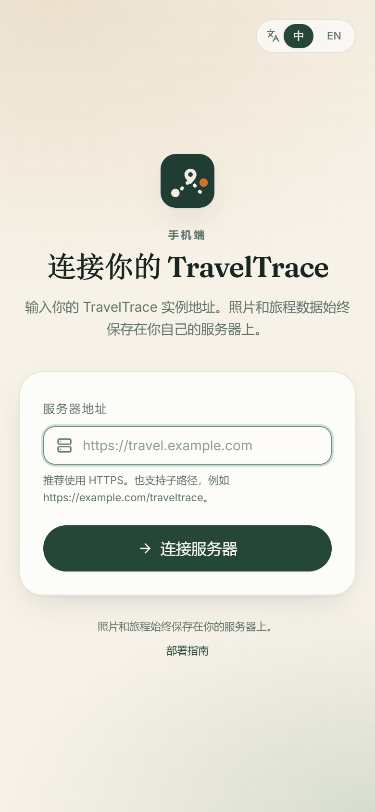
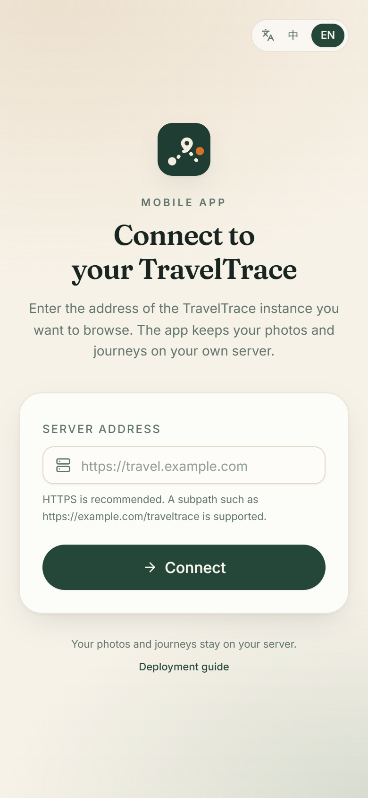

# TravelTrace Android app

TravelTrace includes an Android client built with [Capacitor 7](https://capacitorjs.com/). It
packages the same React interface as the web app and connects to any self-hosted TravelTrace
instance.

## How it works

- The web build (`frontend/dist`) is bundled into the APK.
- On first launch the app asks for the server address, e.g. `https://travel.example.com` or
  `http://192.168.1.20:8080`. The address is stored on the device.

| 中文 | English |
| --- | --- |
|  |  |
- All API calls use that address. The backend must allow the Capacitor origin
  (`http://localhost`, `https://localhost` or `capacitor://localhost`) through CORS. The Docker
  Compose defaults and the backend defaults already include these origins.
- Because a WebView cannot attach an `Authorization` header to `` tags or file downloads, the
  native build appends the JWT as `?access_token=...` to photo files and ZIP exports. Other API
  calls use the normal `Authorization: Bearer` header.
- The server can be changed from the login footer or from **Settings → Mobile server**. Changing it
  clears the local session and returns to the setup screen.

## Requirements

- Node.js 22+
- JDK 21
- Android SDK Platform 35 and Build Tools 35.0.0
- Android Studio is optional; the Gradle wrapper is included

Set `ANDROID_HOME` (or create `frontend/android/local.properties` with `sdk.dir=...`).

## Build a debug APK

```bash
cd frontend
npm ci
npm run mobile:sync          # build web assets + cap sync android

cd android
./gradlew assembleDebug      # Windows: .\gradlew.bat assembleDebug
```

The APK is written to:

```text
frontend/android/app/build/outputs/apk/debug/app-debug.apk
```

Install it on a connected device:

```bash
adb install -r frontend/android/app/build/outputs/apk/debug/app-debug.apk
```

Or copy the APK to the phone and open it (unknown-source installation must be allowed).

## First launch

1. Start a TravelTrace server and make sure `GET /api/v1/health` responds.
2. Open the app, enter the server address and tap **Connect**.
3. Sign in or create the first account.

Server address examples:

| Environment | Address |
| --- | --- |
| Docker Compose on this computer, physical phone | `http://<computer-LAN-IP>:8080` |
| Docker Compose, Android emulator | `http://10.0.2.2:8080` |
| Local uvicorn, Android emulator | `http://10.0.2.2:8000` |
| HTTPS deployment | `https://travel.example.com` |

When testing from a physical phone, start the backend on `0.0.0.0` (not only `127.0.0.1`) and keep
phone and computer on the same network.

HTTPS is strongly recommended. HTTP is supported for local self-hosting, but Android permits
cleartext traffic in this debug-oriented configuration.

## Release signing

Create a keystore outside the repository and configure `signingConfigs` in
`frontend/android/app/build.gradle`:

```bash
keytool -genkey -v -keystore traveltrace-release.jks -keyalg RSA -keysize 2048 \
  -validity 10000 -alias traveltrace
```

Then build:

```bash
cd frontend/android
./gradlew assembleRelease
```

Do not commit the keystore or its passwords. For Google Play, build an `.aab` with
`bundleRelease` and increment `versionCode` / `versionName` in `app/build.gradle`.

## Updating the app

The React UI is bundled in the APK. After changing the web app:

```bash
cd frontend
npm run mobile:sync
cd android
./gradlew assembleDebug
```

`cap sync` copies the new `dist` into the native project. Server-side API changes do not require a
new APK, but web UI changes do.

## Security notes

- Use HTTPS for any server reachable outside a trusted LAN.
- Photo and export URLs contain the JWT in the query string. Treat server access logs as sensitive
  and keep token lifetimes short where possible.
- The Android build enables cleartext traffic for self-hosted HTTP instances. For a production
  release, remove `android:usesCleartextTraffic="true"` and require HTTPS.
- The app uses the existing HttpOnly cookie for the web build; on Android the bearer token is the
  primary authentication mechanism.

## Limitations

- Android is supported first; iOS is not part of this release.
- The app is a Capacitor WebView, not a React Native rewrite.
- No offline photo cache and no push notifications.
- The app bundles its own web UI, so UI updates require a new APK.
